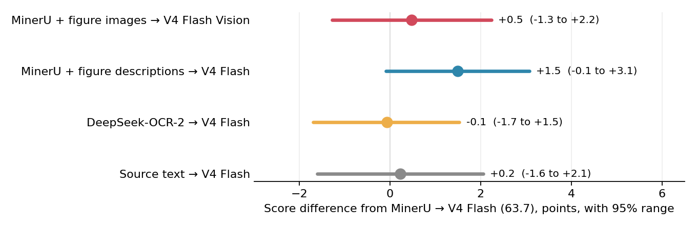
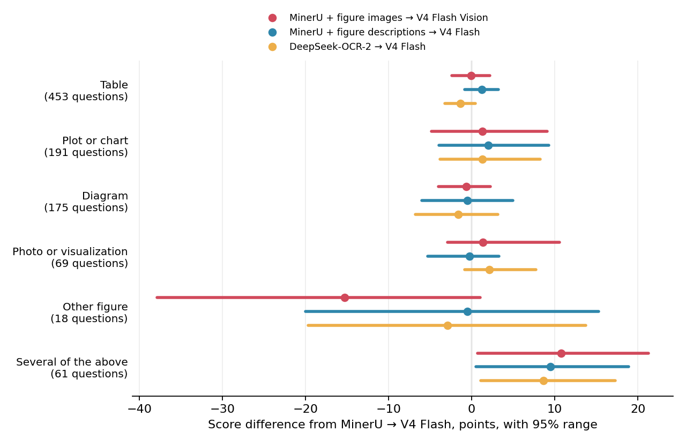
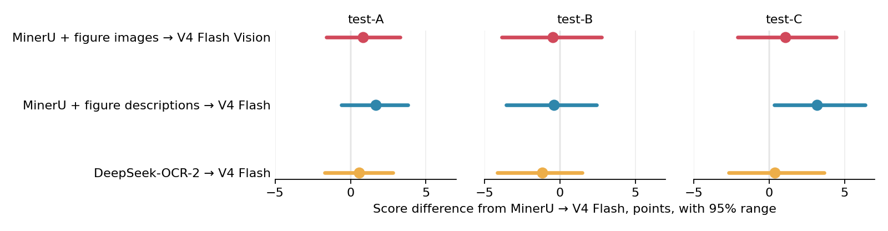
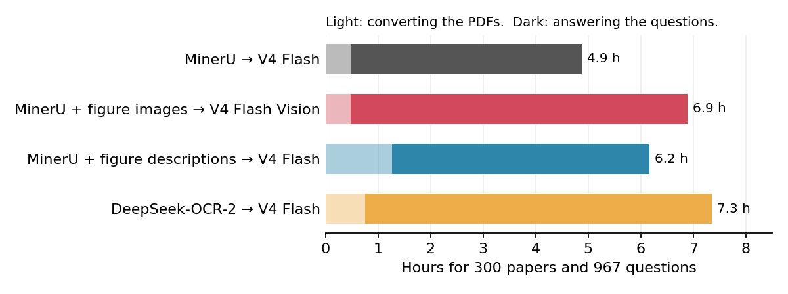

# Is it worth showing scientific figures to a large vision-language model?

At the time of writing, not really. Written descriptions from a much smaller vision-language model, read by a large text-only model, answered questions just as well on [SPIQA](https://huggingface.co/datasets/google/spiqa), a test set built around the figures and tables in research papers.

We converted research papers to text and asked two DeepSeek V4 Flash models questions about them: the text-only release, and the experimental Vision release, which also saw the paper's figure and table images. Adding the images raised the average score by half a point, and each question took about 1.6 times as long, partly because the Vision model ran on different server software. Giving the text-only model MinerU's written description of each figure raised it by 1.5 points. On questions about figures MinerU could describe, images and descriptions each gained about 4 points; on the multi-panel figures it skipped, neither helped. A full DeepSeek-OCR-2 conversion described nearly every figure but scored the same as MinerU's plain text. If you're planning a similar setup, you can use this result instead of running the test yourself.

## The question

When you feed a research paper to a language model, the PDF has to become something the model can read. There are two common ways to do it:

- Text only: convert the PDF to text. Tables become text tables, and each figure is reduced to its caption.
- Text plus images: the same text, plus a picture of each figure and table where it appears in the paper. This needs a model that can read images.

The image version takes more work to build and more compute to run, so we wanted to know whether it gives better answers. We also tried a middle route: describe each figure in words and give those descriptions to the text-only model.

## What we compared

Each setup is named after its pipeline: what converts the PDF, then which model answers. All of them use DeepSeek V4 Flash. The text-only model is release 0731, and the image model is the experimental Vision release.

| Setup | What the model sees | Why it's here |
| --- | --- | --- |
| MinerU → V4 Flash | The paper as text, converted from the PDF by MinerU | Text only, and the baseline every other setup is compared to |
| MinerU + figure images → V4 Flash Vision | The same text, plus MinerU's cut-out images of every figure and table where they appear | Text plus images |
| MinerU + figure descriptions → V4 Flash | The same text, plus MinerU's written description of each figure under its caption | Describes figures instead of showing them |
| DeepSeek-OCR-2 → V4 Flash | The paper converted from the PDF by DeepSeek-OCR-2 alone, including its written reading of every image | A different converter, start to finish, that describes figures as it goes |
| Source text → V4 Flash | A clean text version of the paper made from its source files, not the PDF, plus MinerU's tables | Checks whether PDF conversion loses information |
| No paper → V4 Flash | Just the question | Checks how much can be answered without reading the paper at all |

[MinerU](https://github.com/opendatalab/MinerU) (version 2.5-Pro) is an open-source tool that converts PDFs to text and also crops out the figures and tables as images. [DeepSeek-OCR-2](https://huggingface.co/deepseek-ai/DeepSeek-OCR-2) is DeepSeek's own model for converting document images to text.

## The questions

We used [SPIQA](https://huggingface.co/datasets/google/spiqa), a public set of questions about computer-science papers. Each question has a reference answer. SPIQA's test data comes in three parts, and we used all three:

| Part | Papers | Questions | Where the questions came from |
| --- | --- | --- | --- |
| test-A | 90 | 508 | Written by Google's Gemini model from the figures and tables, then checked by people |
| test-B | 65 | 228 | Written by people (from the QASA dataset) |
| test-C | 145 | 231 | Written by people (from the QASPER dataset) |
| Total | 300 | 967 | |

Many of the questions ask about a specific figure or table, which is where images should help most. Every setup answered all 967 questions, except No paper → V4 Flash, which answered a random 150 of them.

## How answers were scored

Answers are free text, so they can't be compared word for word. We used L3Score, the scoring method from the SPIQA paper: a separate judge model reads the question, the reference answer and the candidate answer, and is asked whether the two answers mean the same thing. The score is how confident the judge is that they do, which we report on a 0 to 100 scale. The SPIQA paper used GPT-4o as the judge; we used Qwen3.8-27B, in a 4-bit community quantization, so that judging runs locally.

The judge gives the same score every time it sees the same answer. An answer that ran out of space before finishing scores 0.

## Results

### Main result: images made no measurable difference

| | MinerU → V4 Flash | MinerU + figure images → V4 Flash Vision | Difference | Likely range of the difference |
| --- | --- | --- | --- | --- |
| All questions | 63.7 | 64.1 | +0.5 | −1.3 to +2.2 |
| test-A | 64.9 | 65.7 | +0.8 | −1.6 to +3.3 |
| test-B | 63.8 | 63.4 | −0.5 | −3.9 to +2.8 |
| test-C | 62.2 | 63.3 | +1.1 | −2.1 to +4.5 |

"Likely range" is a 95% interval: run the test again on a different set of papers and the difference would very probably land inside it. Every range here includes zero, so none of these differences can be told apart from chance. Across all questions, a gain from images of more than about 2 points is unlikely.

### By what the question is about

Each question's reference answer comes from a particular kind of figure or table. Differences are from MinerU → V4 Flash:

| Question is about a... | MinerU → V4 Flash | + figure images (Vision) | Difference | Likely range | Questions |
| --- | --- | --- | --- | --- | --- |
| Table | 62.0 | 61.9 | −0.1 | −2.4 to +2.2 | 453 |
| Plot or chart | 65.3 | 66.6 | +1.3 | −4.9 to +9.1 | 191 |
| Diagram | 69.7 | 69.0 | −0.7 | −4.0 to +2.3 | 175 |
| Photo or visualization | 77.3 | 78.7 | +1.4 | −2.9 to +10.6 | 69 |
| Other figure | 82.1 | 66.8 | −15.3 | −37.9 to +1.0 | 18 |
| Several of the above | 57.4 | 68.2 | +10.7 | +0.7 to +21.3 | 61 |

Images add nothing on table questions. MinerU already writes tables out as text, and the model reads that as well as it reads the picture. Plots and photos lean slightly toward images, but their ranges are wide enough that a modest benefit can't be ruled out.

The last two rows are small groups pointing in opposite directions. With six groups, one range missing zero by chance wouldn't be surprising, so we don't read anything into them.

The same comparison for the two figure-description setups, alongside images:

All three ways of adding figure content gain on the 61 "several of the above" questions: images by 10.7 (+0.7 to +21.3), MinerU's descriptions by 9.5 (+0.5 to +18.9) and DeepSeek-OCR-2 by 8.6 (+1.1 to +17.3). All three setups answered the same 61 questions, so this is one small group seen three times, and a hint at most.

### Figure descriptions: a small gain at most

| | MinerU → V4 Flash | MinerU + figure descriptions → V4 Flash | Difference | Likely range | DeepSeek-OCR-2 → V4 Flash | Difference | Likely range |
| --- | --- | --- | --- | --- | --- | --- | --- |
| All questions | 63.7 | 65.2 | +1.5 | −0.1 to +3.1 | 63.6 | −0.1 | −1.7 to +1.5 |
| test-A | 64.9 | 66.6 | +1.7 | −0.6 to +3.8 | 65.5 | +0.6 | −1.7 to +2.8 |
| test-B | 63.8 | 63.4 | −0.4 | −3.5 to +2.5 | 62.7 | −1.2 | −4.1 to +1.5 |
| test-C | 62.2 | 65.4 | +3.2 | +0.4 to +6.4 | 62.6 | +0.4 | −2.7 to +3.7 |

Adding MinerU's figure descriptions to its text scored 1.5 points higher than the text alone. That's the largest gain of any setup, but its range just reaches zero. It also scored 1.0 points above giving the Vision model the figure images (−0.7 to +2.7).

Converting the whole paper with DeepSeek-OCR-2 instead scored the same as MinerU's plain text, even though OCR-2 described 99.96% of the image boxes it found, against 76% for MinerU. It scored 1.6 points below MinerU with figure descriptions (−3.0 to −0.04), so MinerU's text with its descriptions did slightly better than OCR-2's text with its own.

### Figures MinerU skipped: little was lost

MinerU skipped 24% of figures. It describes photos, diagrams and charts alike, but skips any figure its layout step splits into several images, which is mostly multi-panel plots and photo grids. That cost little, because on questions about those figures the images and DeepSeek-OCR-2's readings didn't help. In a hand check, most of OCR-2's readings of them were wrong or invented. OCR-2 often reads such figures one panel at a time, without the caption, so its reading can't say which panel shows what. Adding figure content of any kind helped only on questions about figures MinerU could describe, by about 4 points. On questions about figures, described or skipped, the difference between MinerU's descriptions and DeepSeek-OCR-2 is within noise.

| Question is about... | Questions | MinerU → V4 Flash | MinerU + figure images → V4 Flash Vision | MinerU + figure descriptions → V4 Flash | DeepSeek-OCR-2 → V4 Flash |
| --- | --- | --- | --- | --- | --- |
| Tables only | 434 | 61.1 | 60.7 | 62.4 | 59.9 |
| Figures MinerU described | 367 | 65.2 | 69.1 | 68.7 | 69.0 |
| Figures MinerU skipped | 114 | 67.3 | 65.5 | 65.4 | 64.6 |

The other 52 questions reference a figure MinerU found under a different label (47) or both described and skipped figures (5). `docs/dropped_descriptions.md` has the full analysis.

### PDF conversion loses almost nothing

| Source text → V4 Flash | MinerU → V4 Flash | Difference | Likely range |
| --- | --- | --- | --- |
| 63.9 | 63.7 | −0.2 | −2.1 to +1.6 |

MinerU's text, made from the PDF, worked as well as clean text made from the papers' source files, so a poor PDF conversion can't explain the main result.

### The paper matters a lot

On the same 150 questions:

| No paper → V4 Flash | MinerU → V4 Flash | MinerU + figure images → V4 Flash Vision |
| --- | --- | --- |
| 29.0 | 54.6 | 54.7 |

Without the paper the model still scores 29, from general knowledge, easy guesses and possibly memory of these papers. With the paper, its score nearly doubles.

### Speed and reliability

| Setup | Median time per question | Slowest 10% take more than | Median output length (tokens) | Answers cut off |
| --- | --- | --- | --- | --- |
| MinerU → V4 Flash | 46 s | 180 s | 315 | 0 of 967 |
| MinerU + figure images → V4 Flash Vision | 72 s | 288 s | 346 | 0 of 967 |
| MinerU + figure descriptions → V4 Flash | 52 s | 197 s | 323 | 0 of 967 |
| DeepSeek-OCR-2 → V4 Flash | 63 s | 257 s | 338 | 1 of 967 |
| Source text → V4 Flash | 46 s | 184 s | 348 | 1 of 967 |
| No paper → V4 Flash | 251 s | 1,304 s | 3,884 | 2 of 150 |

Times were measured with 6 questions in flight at once. The two models ran on different server software (see Setup details), and the server accounts for some of the Vision model's extra time.

Without the paper, the model spends a long time reasoning about which paper the question might mean. That makes it the slowest setup, and the only one with more than one answer cut off.

### Total time for each pipeline

Converting the 300 PDFs (3,533 pages) ran on one RTX 4090. Answering the 967 questions ran on two DGX Sparks, 6 questions at a time. Times are wall-clock, taken from the run logs.

| Setup | Converting 300 papers | Per paper | Answering 967 questions | Per question |
| --- | --- | --- | --- | --- |
| MinerU → V4 Flash | 29 min (MinerU) | 6 s | about 4.4 h | 16 s |
| MinerU + figure images → V4 Flash Vision | 29 min (MinerU) | 6 s | 6.4 h | 24 s |
| MinerU + figure descriptions → V4 Flash | 76 min (MinerU twice) | 15 s | 4.9 h | 18 s |
| DeepSeek-OCR-2 → V4 Flash | 45 min (OCR-2) | 9 s | 6.6 h | 24 s |

Answering takes far longer than converting in every setup. The figure-descriptions setup converts each paper twice: once with MinerU's standard tier for the text (29 min), and again with its advanced tier for the descriptions (47 min). OCR-2 does pages and figure readings in a single 45-minute pass. MinerU → V4 Flash ran together with Source text → V4 Flash, taking 8.8 h for both, so its time is half of that. The DeepSeek-OCR-2 pipeline answers more slowly because its paper text is longer.

## Why images didn't help

The text already carries most of what the figures show. MinerU writes tables out as text and keeps every figure's caption, and in SPIQA's test-A part especially, captions often state the answer outright.

The images do reach the model, though. In an earlier check we gave the Vision model SPIQA's figures and captions with no other paper text, and the images raised its score by 9 points (31.6 to 40.7). Once the full paper text is there, that gain disappears, which suggests the images mostly repeat what the model already has from the text.

## Limitations

- SPIQA covers computer science only. Fields where the main results exist only as images, such as microscopy or medical scans, could behave differently.
- All scores come from one judge model. It passed a basic sanity check, but no person reviewed its scores.
- Each question was answered once. The likely ranges account for which papers were picked, but not for the model giving a different answer if asked again.
- The Vision model is a separate, experimental release, not the text model with vision added. The images comparison is between two complete setups, and we can't say how much of any difference comes from the images and how much from the model.

## Setup details

| | |
| --- | --- |
| Models | Both on two NVIDIA DGX Spark machines, one at a time. Text: `deepseek-ai/DeepSeek-V4-Flash-0731` (revision `7872f01b`), served from a Spark Arena recipe (`c236b076`) on vLLM 0.21.1 (dev build, `ghcr.io/bjk110/vllm-spark`). Images: `deepseek-ai/DeepSeek-V4-Flash-Vision-Exp`, served on vLLM 0.25.2 (dev build, `ghcr.io/anemll/dspark-vllm-gx10:0.1.1`) |
| Generation | Thinking on, "high" reasoning effort, up to 32,768 output tokens, temperature 1.0, top-p 0.95, seed 42, one answer per question |
| PDF conversion | MinerU 2.5-Pro (VLM mode), images cropped at 200 DPI. Figures MinerU split into panels were regrouped under their "Figure N" caption. The figure descriptions come from a second MinerU run at its advanced tier, with image analysis on. DeepSeek-OCR-2 (revision `aaa02f38`): pages rendered at 144 DPI and read in document mode, then each image it boxed read again with "Parse the figure.", following DeepSeek's own PDF script. |
| PDF versions | test-A: the arXiv version SPIQA lists. test-B and test-C list none, so we used the latest arXiv version before the source dataset's release (QASA: 2023-07-01, QASPER: 2021-05-07). |
| Judge | Qwen3.8-27B (4-bit), thinking off, SPIQA's L3Score prompt word for word, scored from the Yes/No probabilities of the first token |
| Averages | Each of the three parts counts equally |
| Likely ranges | 95% bootstrap intervals that resample whole papers within each part, 10,000 times, since questions from the same paper tend to be scored alike |

### The two PDF converters

| | MinerU 2.5-Pro | DeepSeek-OCR-2 |
| --- | --- | --- |
| Papers converted | 300 of 300 | 300 of 300 |
| Pages dropped | 0 of 3,533 | 5 of 3,533 |
| Image boxes found | 2,460 | 2,335 |
| Image boxes with a description | 1,858 (76%) | 2,334 (99.96%) |

Both models often box each panel of a figure separately, so they find more image boxes than the papers have figures. After its panels were regrouped under their "Figure N" captions, 1,156 of 1,512 figures (76%) reached the model with a description. MinerU skipped figures with several panels far more often than single-panel figures (42% against 17%).

OCR-2 dropped 5 pages because it never finished them: it got stuck repeating itself until it hit its token limit. DeepSeek's own PDF script drops such pages, and so did we. A further 57 of its figure descriptions were cut off at the token limit, usually partway through a table of empty cells. Those went to the model as they were.

The vLLM build we used for the text model mislabels its reasoning effort levels: sending "max" gets the model's real "high" setting. So we sent "max" to the text model and "high" to the Vision model, and checked that both produce the same instruction text.

Files in this repository:

- `config.toml`: the fixed settings for every setup. The address serving the DeepSeek models goes in a local `.env` file as `DEEPSEEK_BASE_URL=http://host:port/v1`, with `CONTACT_EMAIL=` for the arXiv downloads
- `requirements/`: the packages for each Python environment
- `intake/` and `scripts/`: the code for sampling, conversion, answering, judging and analysis. `scripts/fetch_data.py` and `scripts/fetch_pdfs.py` download the data and models
- `data/samples/`: the sampled papers and questions
- `runs/analysis.json`: the raw numbers behind every table
- `docs/dropped_descriptions.md`: which figures MinerU left undescribed, why, and what DeepSeek-OCR-2 wrote for them
- `figures/`: the charts above, drawn by `scripts/make_figures.py` from `runs/analysis.json`
